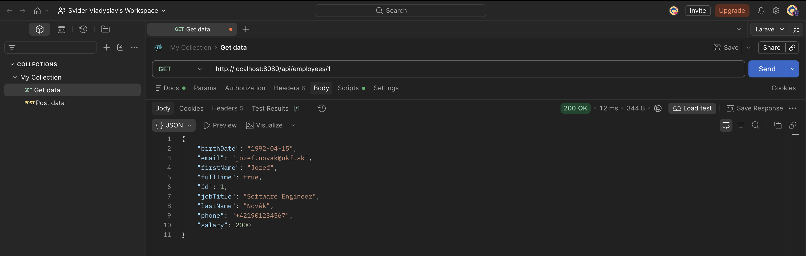
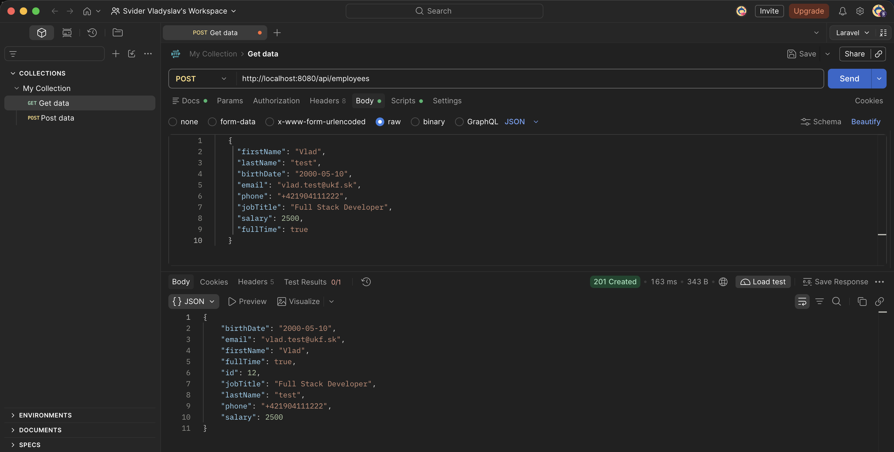
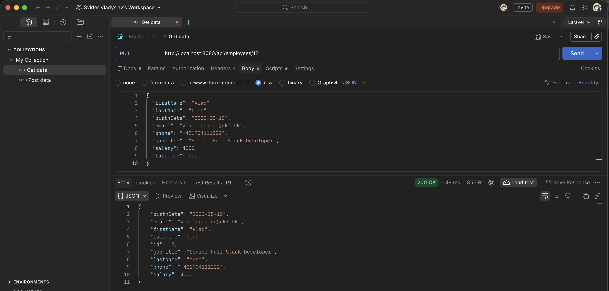
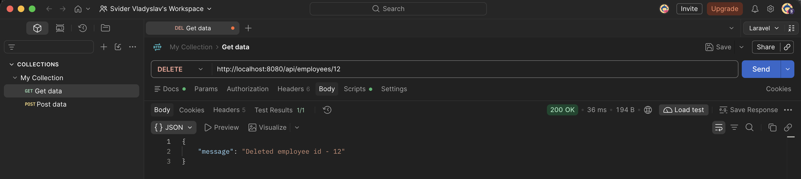

# Zadanie 3 – Adresár zamestnancov (REST API CRUD)

## Endpointy

| HTTP metóda | Endpoint              | Popis                      | Úspešný status |
|-------------|-----------------------|----------------------------|----------------|
| GET         | `/api/employees/{id}` | Jeden zamestnanec podľa ID | 200 OK         |
| POST        | `/api/employees`      | Vytvorenie zamestnanca     | 201 Created    |
| PUT         | `/api/employees/{id}` | Aktualizácia zamestnanca   | 200 OK         |
| DELETE      | `/api/employees/{id}` | Zmazanie zamestnanca       | 200 OK         |

## Testovanie v Postmane

### 1. GET `/api/employees/{id}`

### 2. POST `/api/employees`

### 3. PUT `/api/employees/{id}`

### 4. DELETE `/api/employees/{id}`

